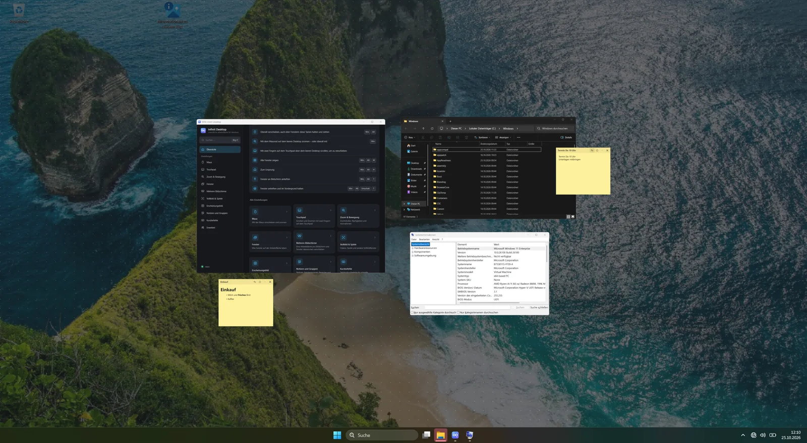
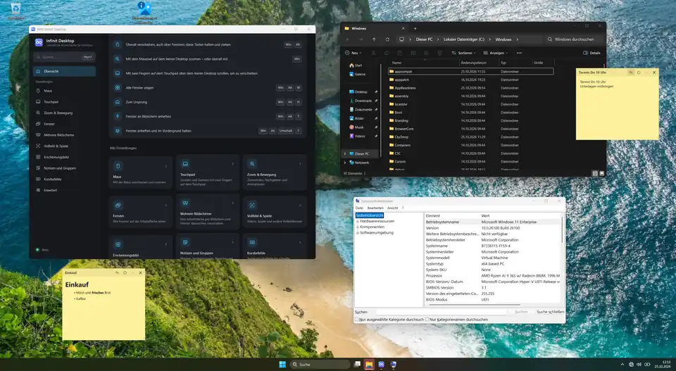

# WIN Infinit Desktop

**Eine unendliche Arbeitsfläche für Windows 11 – auf jedem Bildschirm.**
*If it runs Windows 11, it runs WIN Infinit Desktop.*

WIN Infinit Desktop ist die Windows-Version von [KDE Infinit Desktop](https://github.com/RandomNam3/kde-infinit-desktop)
(Windows 11 24H2, 25H2 und 26H2). Jeder Monitor wird zu einer in alle Richtungen unendlichen Fläche, auf der
Fenster in Originalgröße liegen. Du verschiebst die Fläche mit Maus, Touchpad oder Tastatur, zoomst mit dem
Mausrad heraus, um alles zu überblicken, und wieder hinein, um weiterzuarbeiten. Taskleiste und
Hintergrundbild bleiben dabei fest stehen.



| Fläche verschieben | Heraus- und hineinzoomen |
|---|---|
|  |  |
| **Notizen** | **Menü der Arbeitsfläche** |
|  |  |

## Funktionen

- **Unendliche Fläche pro Bildschirm und virtuellem Desktop** mit eigener Kamera und Lesezeichen.
- **Pannen**: Ziehen auf freiem Desktop, Win+Alt+Ziehen über Fenstern, mittlere Maustaste,
  Zwei-Finger-Scrollen, Umschalt/Strg + Mausrad; mit **Nachgleiten**.
- **Zoomen**: Mausrad auf freiem Desktop, Win+Mausrad überall, Pinch; rastet bei 100 % ein.
- **Übersicht**: Herausgezoomt liegen alle Fenster als Live-Vorschau auf der Fläche. Fenster lassen sich
  dort verschieben (Titelleiste) und in der Größe ändern (Ränder), ein Klick in ein Fenster taucht ein.
- **Nichts geht verloren**: Markierungen am Bildschirmrand zeigen, wo Fenster außerhalb des Bildes liegen,
  ein Klick fliegt hin. Taskleiste und Alt+Tab fahren die Kamera zum gewählten Fenster.
- **Mehrere Bildschirme**:
  - Jeder Monitor hat seine eigene Fläche.
  - Auf den anderen Monitor kommt ein Fenster nur durch **schnelles Ziehen an den Rand**, die
    Geschwindigkeit ist einstellbar.
  - Langsames Ziehen scrollt stattdessen die Fläche.
- **Vollbild**: Videos und Spiele bleiben stehen und lassen sich nicht wegscrollen, solange sie den Fokus
  haben.
- **Anpinnen** von Fenstern an den Bildschirm, optional **immer im Vordergrund**.
- **Fenster öffnen sich dort, wo sie zuletzt waren**: Position, Größe und Bildschirm werden gemerkt.
  Monitore werden über ihre EDID-Daten wiedererkannt.
- **Notizen**: Zettel mit Markdown, die auf der Fläche liegen, automatisch gespeichert werden und sich
  anheften lassen. Sie öffnen sich zum Schreiben, der Stift in der Kopfzeile zeigt sie formatiert.
- **Gruppen**: Programme, die zusammengehören, öffnen sich mit Win+Alt+F1 … F9 gemeinsam an ihrem Ort,
  immer gleich angeordnet; fehlende Programme werden gestartet.
- **Bereiche und Karte**: benannte Bereiche der Fläche, die mit ihren Fenstern wachsen, und eine Karte der
  ganzen Fläche, auf der du die Kamera mit der Maus bewegst.
- **Menü der Arbeitsfläche**: Rechtsklick auf die freie Fläche in der Übersicht, Win+Rechtsklick auf den
  Desktop bei 100 %. Alle Menüs folgen dem hellen oder dunklen Modus von Windows.
- **Frei belegbare Tastenkürzel**: Zoom, Übersicht, Ursprung, Fenster in eine Richtung, Lesezeichen,
  Anpinnen, Notizen, Gruppen. Überschneidungen mit Windows-Kürzeln zeigt die Einstellungs-App.
- **Einstellungs-App** mit Suche, Erklärung zu jeder Option, sofortiger Übernahme und **Update-Check**.
- **Symbol im Infobereich** mit allen Aktionen.
- **Robust**: Absicherung gegen Absturzschleifen (abgesicherter Modus); beim Beenden, Abmelden und nach
  einem Absturz kommen alle Fenster auf den Bildschirm zurück; in Ruhe keine Leistungskosten.

## Installation

Ein Befehl in PowerShell, als normaler Benutzer:

```powershell
irm https://raw.githubusercontent.com/RandomNam3/win-infinit-desktop/main/install.ps1 | iex
```

Er lädt das neueste Release von GitHub, prüft dessen SHA-256-Prüfsumme und startet den Installer. Von
Hand geht es auch: aus dem [neuesten Release](https://github.com/RandomNam3/win-infinit-desktop/releases/latest)
`win-infinit-desktop-<Version>-x64.zip` herunterladen, entpacken und im entpackten Ordner ausführen:

```powershell
powershell -NoProfile -ExecutionPolicy Bypass -File .\install.ps1
```

Der Installer:
- installiert für den angemeldeten Benutzer, **ohne Administratorrechte**, nach
  `%LOCALAPPDATA%\Programs\WIN Infinit Desktop`,
- legt Einträge im **Startmenü** und im **Autostart** an,
- trägt das Programm unter *Einstellungen → Apps* ein (dort lässt es sich auch entfernen),
- startet WIN Infinit Desktop. Das Symbol erscheint im Infobereich.

Updates installiert die Einstellungs-App. Alles Weitere, auch Deinstallieren und Fehlerbehebung, steht in
[docs/INSTALL.md](docs/INSTALL.md).

## Dokumentation

| Dokument | Inhalt |
|---|---|
| [docs/BENUTZERHANDBUCH.md](docs/BENUTZERHANDBUCH.md) | Bedienung, Tastenkürzel, Einstellungen, Fehlerbehebung |
| [docs/INSTALL.md](docs/INSTALL.md) | Installieren, Updates, Deinstallieren, selbst bauen |
| [docs/ARCHITEKTUR.md](docs/ARCHITEKTUR.md) | Technische Dokumentation: Windows-Schnittstellen, Aufbau, Datenmodell, Stabilität, Tests |

## Selbst bauen

```powershell
cmake -S . -B build -G Ninja -DCMAKE_BUILD_TYPE=Release -DCMAKE_PREFIX_PATH=C:\Qt\6.8.3\msvc2022_64
cmake --build build
ctest --test-dir build
pwsh scripts/package.ps1 -Build build      # ZIP wie im Release
```

Abhängigkeiten: Visual Studio 2022 oder 2026 (C++), CMake ≥ 3.22, Ninja, Qt ≥ 6.8 für MSVC (Core, Gui,
Network, Qml, Quick, QuickControls2). Nur das Diagnose-Werkzeug `wid-probe` (ohne Qt): `-DWID_WITH_QT=OFF`.
Details in [docs/INSTALL.md](docs/INSTALL.md#7-selbst-bauen).

## Lizenz

GPL-3.0-or-later. Windows ist eine Marke der Microsoft Corporation; dieses Projekt ist ein unabhängiges
Community-Projekt.
