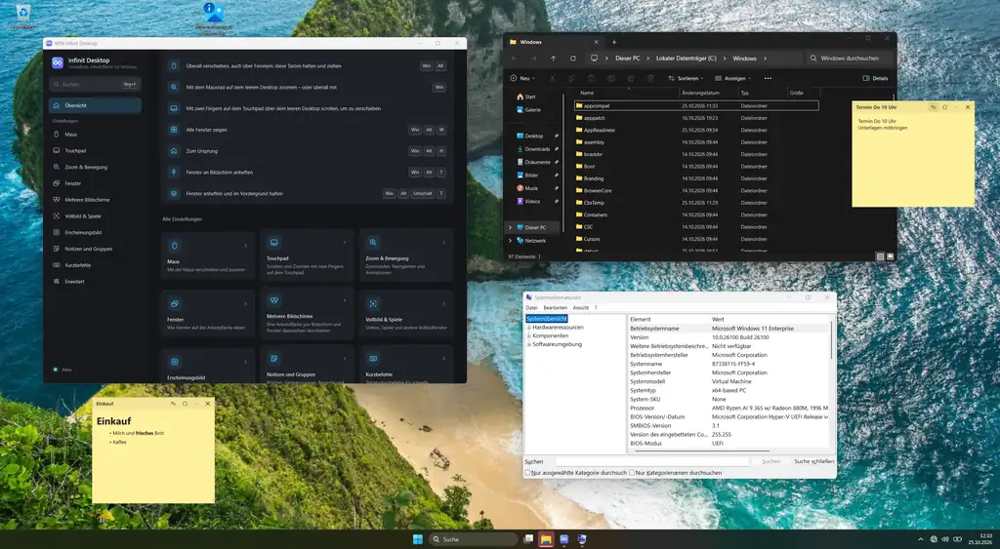
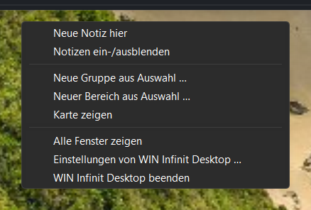
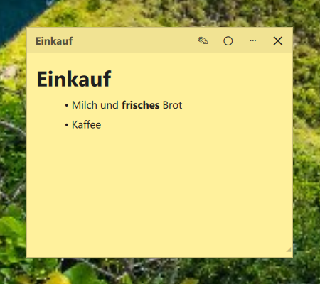
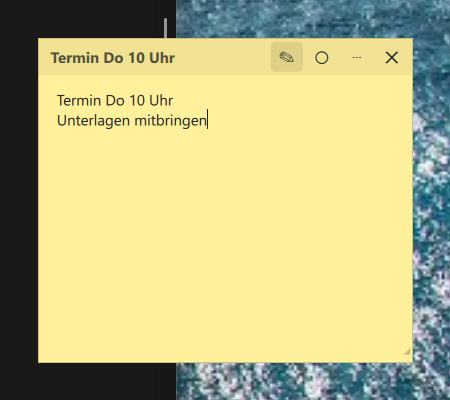
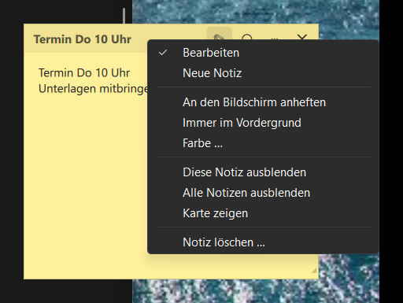
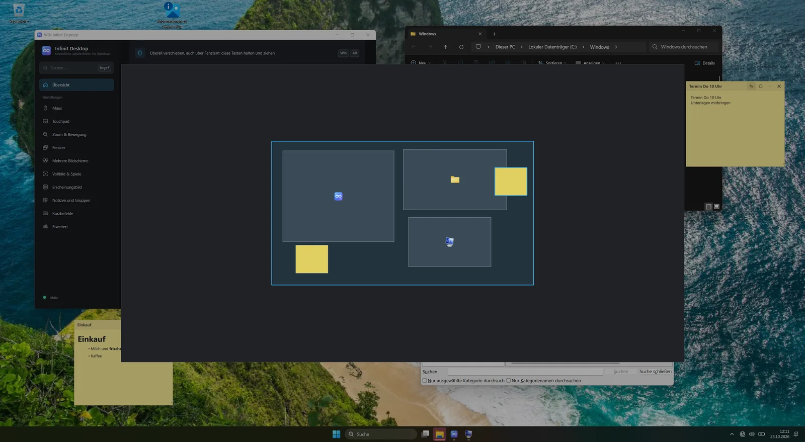

# WIN Infinite Desktop – Benutzerhandbuch

> *If it runs Windows 11, it runs WIN Infinite Desktop.*

WIN Infinite Desktop macht jeden Bildschirm zu einer **unendlich großen Arbeitsfläche**. Fenster liegen in
Originalgröße auf dieser Fläche, dein Bildschirm ist wie eine Kamera, die einen Ausschnitt davon zeigt.
Du kannst die Fläche in jede Richtung verschieben, herauszoomen, um alles zu überblicken, und wieder
hineinzoomen – die Taskleiste und das Hintergrundbild bleiben dabei, wo sie sind.

---

## Inhalt

1. [Voraussetzungen](#voraussetzungen)
2. [Installieren und starten](#installieren-und-starten)
3. [Die wichtigsten Begriffe](#die-wichtigsten-begriffe)
4. [Bedienung mit Maus](#bedienung-mit-maus)
5. [Bedienung mit Touchpad](#bedienung-mit-touchpad)
6. [Tastenkürzel](#tastenkürzel)
7. [Fenster: finden, anpinnen, immer oben](#fenster-finden-anpinnen-immer-oben)
8. [Fenster öffnen sich dort, wo sie zuletzt waren](#fenster-öffnen-sich-dort-wo-sie-zuletzt-waren)
9. [Notizen, Gruppen, Bereiche und die Karte](#notizen-gruppen-bereiche-und-die-karte)
10. [Mehrere Bildschirme](#mehrere-bildschirme)
11. [Virtuelle Desktops](#virtuelle-desktops)
12. [Vollbild, Videos und Spiele](#vollbild-videos-und-spiele)
13. [Das Symbol im Infobereich](#das-symbol-im-infobereich)
14. [Einstellungen](#einstellungen)
15. [Verträglichkeit mit anderen Programmen](#verträglichkeit-mit-anderen-programmen)
16. [Fehlerbehebung](#fehlerbehebung)
17. [Häufige Fragen](#häufige-fragen)

---

## Voraussetzungen

| | |
|---|---|
| System | Windows 11 **24H2 oder neuer** (25H2 und 26H2 werden unterstützt) |
| Prozessor | x64 |
| Benutzerkonto | ein normales Konto, Administratorrechte sind nicht nötig |
| Bildschirme | beliebig viele, mit beliebiger Skalierung |

## Installieren und starten

Die ausführliche Anleitung steht in [INSTALL.md](INSTALL.md). Kurzfassung: in PowerShell ausführen

```powershell
irm https://raw.githubusercontent.com/RandomNam3/win-infinite-desktop/main/install.ps1 | iex
```

oder das ZIP aus dem neuesten Release entpacken und im Ordner `install.ps1` ausführen.

Danach startet WIN Infinite Desktop bei jeder Anmeldung von selbst. Das Symbol im Infobereich der
Taskleiste zeigt, dass es läuft.

**Beenden:** Symbol im Infobereich → *Beenden*. Alle Fenster, die gerade außerhalb des sichtbaren
Bereichs lagen, kommen dabei auf den Bildschirm zurück – es geht nichts verloren. Dasselbe passiert beim
Abmelden und Herunterfahren.

## Die wichtigsten Begriffe

**Arbeitsfläche (Canvas)** – die unendliche Fläche. Jeder Bildschirm hat seine **eigene** Fläche, und jeder
[virtuelle Desktop](#virtuelle-desktops) hat pro Bildschirm wieder eine eigene.

**Kamera** – der sichtbare Ausschnitt. Verschieben („pannen“) bewegt die Kamera, zoomen verändert,
wie viel der Fläche du siehst.

**100 % und Übersicht** – bei 100 % arbeitest du ganz normal mit allen Fenstern. Sobald du herauszoomst,
bist du in der *Übersicht*: Alle Fenster erscheinen verkleinert als Live-Vorschau auf der Fläche, über
einem abgedunkelten Hintergrundbild mit Punktraster. Die Taskleiste bleibt sichtbar.

**Statisch bleibt:** das Hintergrundbild, die Taskleiste, angepinnte Fenster und Vollbild-Fenster.

**Geparkte Fenster** – Fenster, die gerade nicht im Bild sind, legt WIN Infinite Desktop außerhalb aller
Bildschirme ab. Viele Programme (alle auf Chromium-Basis wie Edge, Chrome, Teams oder Discord) hören dann
auf zu zeichnen und sparen Strom.

## Bedienung mit Maus

| Aktion | Wirkung |
|---|---|
| **Linke Maustaste ziehen auf freiem Desktop** | Fläche verschieben (ein kurzer Klick erreicht weiterhin den Desktop) |
| **Mittlere Maustaste ziehen auf freiem Desktop** | Fläche verschieben |
| **Win + Alt + linke Maustaste ziehen** (überall) | Fläche verschieben, auch über Fenstern |
| **Mausrad auf freiem Desktop** | Zoomen (zur Mausposition hin) |
| **Win + Mausrad** (überall) | Zoomen, auch über Fenstern |
| **Umschalt + Mausrad** auf freiem Desktop | waagerecht verschieben |
| **Strg + Mausrad** auf freiem Desktop | senkrecht verschieben |
| Fenster an den **Bildschirmrand ziehen** | die Fläche scrollt in diese Richtung, das Fenster wandert mit |
| Nach schnellem Ziehen **loslassen** | die Fläche gleitet nach und bremst sanft ab |
| **Klick**, während die Fläche noch gleitet oder fährt | hält sie an; der nächste Klick geht an das Fenster |

Das Startmenü öffnet sich bei Win + Mausrad und Win + Alt + Ziehen nicht: WIN Infinite Desktop sorgt dafür,
dass Windows das Loslassen der Win-Taste nicht als einzelnen Tastendruck sieht.

Beim Zurückzoomen rastet der Zoom genau bei 100 % ein – dann sind alle Fenster wieder direkt bedienbar.

Nachgleiten gibt es nur nach einem zügigen, geraden Wisch. Kreist du mit gedrückter Maustaste und lässt
dann los, bleibt die Fläche stehen.

### Herausgezoomt arbeiten: die Übersicht

| Aktion | Wirkung |
|---|---|
| **Titelleiste** einer Vorschau ziehen | Fenster auf der Fläche verschieben |
| **Rand oder Ecke** ziehen | Fenstergröße ändern |
| In ein Fenster **klicken** oder **Doppelklick auf die Titelleiste** | eintauchen: zurück auf 100 % mit diesem Fenster in der Mitte, dann ist es aktiv |
| Ziehen auf freier Fläche oder im Fensterinhalt, mittlere Maustaste | Fläche verschieben |
| **Mausrad** | zoomen zum Mauszeiger |
| **Rechtsklick** auf freie Fläche | [Menü der Arbeitsfläche](#das-menü-der-arbeitsfläche) |
| **Esc** | zurück auf 100 % |

**Tippen** geht auch herausgezoomt an das aktive Fenster. Die Übersicht selbst wird nie aktiv.

Windows zeichnet fremde Programme immer in ihrer vollen Größe; in der Übersicht siehst du verkleinerte
Abbilder. Die echten Fenster bleiben hinter der Übersicht verdeckt stehen, bis du wieder auf 100 % bist.
Fenster, die gerade außerhalb des Bildes liegen, zeigen dort ihr zuletzt gezeichnetes Bild.



### Fenster außerhalb des Bildes wiederfinden

Liegt ein Fenster außerhalb des sichtbaren Bereichs, zeigt eine kleine **Markierung mit dem Programmsymbol**
am Bildschirmrand, in welche Richtung es liegt. Ein Klick darauf fliegt zum Fenster. Standardmäßig sind die
Markierungen beim Verschieben und Zoomen sichtbar und blenden danach aus; einstellbar unter
*„Markierungen für Fenster außerhalb des Bildes“* (nie / beim Verschieben oder Zoomen / immer). Weitere
Wege: die Taskleiste, Alt+Tab und Win + Alt + W (alle Fenster zeigen).

## Bedienung mit Touchpad

| Geste | Wirkung |
|---|---|
| **Zwei-Finger-Scrollen** auf freiem Desktop | Fläche verschieben |
| **Zwei-Finger-Pinch** auf freiem Desktop | Zoomen |

Über Fenstern scrollt das Touchpad wie gewohnt im Programm. Die Drei- und Vier-Finger-Gesten bleiben die
von Windows (Task View, Desktop wechseln).

## Tastenkürzel

Alle Kürzel sind frei änderbar – in der Einstellungs-App auf der Seite *Kurzbefehle*. Die Seite *Mit
Windows* zeigt die Kürzel von Windows 11 und markiert Überschneidungen.

| Kürzel | Aktion |
|---|---|
| Win + Alt + `=` / `+` (auch Ziffernblock) | Hineinzoomen |
| Win + Alt + `-` (auch Ziffernblock) | Herauszoomen |
| Win + Alt + `0` | Zurück auf 100 % |
| Win + Alt + W | Alle Fenster dieses Bildschirms zeigen (nochmal: zurück) |
| Win + Alt + H | Zum Ursprung der Fläche (nochmal: zurück) |
| Win + Alt + C | Aktives Fenster in die Mitte holen |
| Win + Alt + Umschalt + Pfeiltasten | Ansicht verschieben |
| Win + Strg + Alt + Pfeiltasten | Zum nächsten Fenster in dieser Richtung springen |
| Win + Alt + 1 … 4 | Lesezeichen 1 … 4 anspringen |
| Win + Strg + Alt + 1 … 4 | Aktuelle Ansicht als Lesezeichen 1 … 4 speichern |
| Win + Alt + T | Fenster an den Bildschirm anpinnen / lösen |
| Win + Alt + Umschalt + T | Fenster anpinnen **und immer im Vordergrund** / lösen |
| *(frei)* | Gesten pausieren / fortsetzen |
| Win + Alt + N | Neue Notiz an der Mausposition |
| Win + Alt + Umschalt + N | Alle Notizen aus- / einblenden |
| Win + Alt + M | Karte der Fläche zeigen / schließen |
| Win + Alt + G | Rechteck aufziehen: die Fenster darin werden eine Gruppe |
| Win + Alt + B | Rechteck aufziehen: ein neuer Bereich |
| Win + Alt + Umschalt + G | Anordnung der Gruppe des aktiven Fensters speichern |
| Win + Alt + F1 … F9 | Gruppe 1 … 9 öffnen bzw. zusammenholen |

Win + Alt + B (HDR ein/aus) und Win + Alt + G (Game Bar: Aufnahme der letzten Minuten) belegt auch
Windows. Solange WIN Infinite Desktop läuft, gelten sie für WIN Infinite Desktop. Brauchst du die
Windows-Funktion, belege das Kürzel in der Einstellungs-App um.

## Fenster: finden, anpinnen, immer oben

**Fenster finden:** Klickst du in der Taskleiste auf ein Fenster oder wählst es mit Alt+Tab, fährt die
Kamera automatisch hin (*„Aktivierte Fenster ins Bild holen“*). Wahlweise nur so weit wie nötig oder
genau in die Mitte. Fenster außerhalb des Bildes zeigen außerdem
[Markierungen am Bildschirmrand](#fenster-außerhalb-des-bildes-wiederfinden).

**Anpinnen (Win + Alt + T):** Ein angepinntes Fenster bleibt an seiner Stelle auf dem Bildschirm und wird
vom Verschieben und Zoomen der Fläche nicht beeinflusst – praktisch für Chat, Musik oder ein
Bild-im-Bild-Video. Du kannst es weiterhin frei verschieben. Nochmal Win + Alt + T legt es wieder auf die
Fläche, genau an die Stelle, an der es gerade zu sehen ist.

**Immer oben (Win + Alt + Umschalt + T):** wie Anpinnen, zusätzlich bleibt das Fenster über allen anderen.
Beim Lösen und beim Beenden von WIN Infinite Desktop wird „immer im Vordergrund“ wieder zurückgenommen.
Mit der Option, Fenster mit „immer im Vordergrund“ anzupinnen, werden auch Fenster angepinnt, die ein
Programm selbst über alle anderen legt.

## Fenster öffnen sich dort, wo sie zuletzt waren

Wird ein Programmfenster geschlossen, merkt sich WIN Infinite Desktop **Stelle auf der Fläche, Größe,
Bildschirm und Anpinnen**. Das nächste Fenster dieses Programms öffnet sich wieder dort – liegt die Stelle
gerade nicht im Bild, fährt die Kamera hin.

- Programme werden über ihre App-ID erkannt, sonst über den Programmpfad.
- Bildschirme werden über **Hersteller und Modell** wiedererkannt, nicht nur über den Anschluss.
- Fehlt der Bildschirm, öffnet sich das Fenster auf dem aktuellen Bildschirm.
- Mehrere Fenster eines Programms bekommen nacheinander ihre jeweils zuletzt benutzten Plätze.
- Angepinnt wird ein Fenster nur wieder, wenn gerade kein anderes Fenster dieses Programms offen ist.
- Maximierte und Vollbild-Fenster sind ausgenommen, ebenso Programme in der Liste *„Anwendungen, die immer
  normal öffnen“*.
- *„Wo wieder geöffnete Fenster erscheinen“*: an derselben Stelle **der Fläche** (Standard) oder an
  derselben Stelle **des Bildschirms**.
- Gespeicherte Positionen lassen sich in der Einstellungs-App ansehen und löschen.

## Notizen, Gruppen, Bereiche und die Karte

### Das Menü der Arbeitsfläche

Herausgezoomt öffnet ein **Rechtsklick auf die freie Fläche** ein Menü mit den folgenden Einträgen:
- neue Notiz und Notizen ein-/ausblenden;
- neue Gruppe und neuer Bereich;
- Bereich entfernen, wenn du auf einem Bereich klickst;
- Karte, alle Fenster zeigen, 100 %, Einstellungen und Beenden.

Bei 100 % öffnet es **Win + Rechtsklick** auf den Desktop; der normale Rechtsklick zeigt weiter das
Desktop-Menü von Windows.

Das Menü der Arbeitsfläche, das Menü des Symbols im Infobereich und die Menüs der Notizen sind Menüs von
Windows: Sie sehen gleich aus und folgen dem hellen oder dunklen Modus (*Einstellungen →
Personalisierung → Farben → Modus*).



### Notizen

Notizen sind kleine Zettel, die wie Fenster auf der Fläche liegen. Neu anlegen kannst du sie auf drei Wegen:
- **Win + Alt + N** an der Mausposition;
- über das Menü der Arbeitsfläche;
- über das **Symbol im Infobereich** (*Neue Notiz*).

- **Schreiben:** Eine Notiz öffnet sich mit ihrem Text zum Bearbeiten. Markdown geht: `# Überschrift`,
  `**fett**`, `*kursiv*`, `- Liste`, `[Link](https://…)`.
- **Formatiert ansehen:** Der Stift ✎ in der Kopfzeile oder **Strg + E** zeigt den Text formatiert, mit
  anklickbaren Links; nochmal schaltet zurück zum Bearbeiten, ebenso ein Doppelklick in den Text. Jede
  Notiz merkt sich ihre Ansicht.
- **Speichern** passiert automatisch, kurz nach dem Tippen. Jede Notiz ist eine Markdown-Datei unter
  `%APPDATA%\WIN Infinite Desktop\notes\` und lässt sich auch dort lesen.
- **Verschieben** an der Kopfzeile, **Größe ändern** an der Ecke rechts unten. Notizen öffnen sich wieder
  genau dort, wo sie lagen.
- **Anheften** (Knopf ◉ in der Kopfzeile): Die Notiz bleibt am Bildschirm, auch wenn die Kamera
  weiterzieht – praktisch für eine Einkaufsliste oder Aufgaben, die immer sichtbar sein sollen.
- **Ausblenden:** ✕ blendet eine Notiz aus (sie bleibt erhalten), **Win + Alt + Umschalt + N** blendet
  alle aus und wieder ein, ebenso *Notizen ein-/ausblenden* im Menü des Symbols.
- **Menü der Notiz:** ⋯ in der Kopfzeile oder ein **Rechtsklick irgendwo in die Notiz** öffnet es:
  Bearbeiten, neue Notiz, anheften, *Farbe …*, ausblenden, Karte und löschen. Im Text bietet der
  Rechtsklick zusätzlich Rückgängig, Wiederholen, Ausschneiden, Kopieren, Einfügen und Alles auswählen.

| Formatiert | Beim Schreiben | Menü der Notiz |
|---|---|---|
|  |  |  |

Notizen stehen nicht in der Taskleiste und nicht in Alt+Tab.

### Gruppen

Eine Gruppe sind Programme, die zusammengehören – zum Beispiel E-Mail, Kalender und Notizen, oder Editor,
Terminal und Browser für ein Projekt.

- **Anlegen:** Win + Alt + G drücken und ein Rechteck um die offenen Fenster aufziehen, oder in der
  Einstellungs-App unter *Notizen und Gruppen* eine Gruppe anlegen und Programme aus dem Startmenü
  hinzufügen.
- **Öffnen:** **Win + Alt + F1** öffnet die erste Gruppe, F2 die zweite usw. Auch das Menü des Symbols
  im Infobereich hat alle Gruppen (*Gruppe öffnen*).
  - Die Fenster der Gruppe kommen an den Ort, an dem die Gruppe zuletzt war, immer gleich angeordnet und
    gleich groß. Minimierte Fenster werden wiederhergestellt.
  - Fehlt ein Programm, wird es gestartet und sein Fenster an seinen Platz gelegt.
  - Die Kamera springt hin. Ist die Gruppe größer als der Bildschirm, zoomt sie so weit heraus, dass
    alles zu sehen ist.
- **Programme in mehreren Gruppen:** Ist zum Beispiel der Browser in zwei Gruppen und nur ein
  Browserfenster offen, springt er mit der Gruppe mit, die du gerade öffnest. Sind mehrere offen, nimmt
  jede Gruppe „ihr“ Fenster.
- **Anordnung:** Für jede Gruppe stellst du ein, wann sie sich die Anordnung merkt:
  - *Beim Speichern* (Standard): Erst Win + Alt + Umschalt + G oder der Knopf in der App macht die
    jetzige Anordnung zur neuen. Zwischendurch kannst du Fenster frei verschieben, die Gruppe öffnet
    trotzdem immer gleich.
  - *Automatisch*: Jede Änderung, solange die Gruppe offen ist, wird zur neuen Anordnung.

  Der **Ort** der Gruppe wandert in beiden Fällen mit ihren Fenstern mit.
- **Reihenfolge:** In der App bestimmst du die Reihenfolge der Gruppen und damit ihr Tastenkürzel
  (F1 … F9).

### Bereiche

Mit **Win + Alt + B** ziehst du einen Bereich auf: einen benannten Teil der Fläche, etwa „Projekt“,
„Lesen“ oder „Privat“. Bereiche siehst du herausgezoomt als farbige Flächen unter den Fenstern und auf
der Karte.

- Ziehst du ein Fenster in einen Bereich, gehört es dazu. Der Bereich **wächst mit**, wenn das Fenster über
  seinen Rand ragt oder größer wird, und **schrumpft**, wenn Fenster ihn verlassen oder kleiner werden.
- Ein fester Bereich (Schalter *Wächst mit seinen Fenstern* in der App aus) behält seine Größe.
- Umbenennen und entfernen geht in der App, entfernen auch über das Menü der Arbeitsfläche.

### Die Karte

**Win + Alt + M** zeigt eine Karte der ganzen Fläche dieses Bildschirms mit allen Fenstern, Notizen,
Gruppen und Bereichen. Das helle Rechteck ist der sichtbare Ausschnitt.

- **Ziehen** verschiebt die Kamera, **Klick** fährt an diese Stelle.
- Das **Mausrad** zoomt, **Esc** oder ein Klick neben die Karte schließt sie.



## Mehrere Bildschirme

Jeder Bildschirm hat seine eigene, unabhängige Fläche.

**An der Kante zum Nachbarbildschirm** verschwindet ein Fenster beim Verschieben, sobald es auf den
anderen Bildschirm reichen würde, und erscheint wieder, wenn es ganz auf seinen eigenen passt. Windows
kann ein fremdes Fenster nicht an einer Bildschirmkante abschneiden; so taucht nichts von einer Fläche auf
dem anderen Bildschirm auf. Eine Markierung am Rand zeigt das Fenster, ein Klick darauf holt es ins Bild.
Ein Fenster, das du selbst über die Kante legst oder das ein Programm dort öffnet, bleibt, wo es ist.

**Fenster auf den anderen Bildschirm bringen:** Ziehe das Fenster **schnell** gegen den Rand zum
Nachbarbildschirm („werfen“). Ziehst du langsam, bleibt das Fenster auf seinem Bildschirm, und die Fläche
scrollt stattdessen in diese Richtung. Die nötige Geschwindigkeit stellst du unter *„Nötige
Geschwindigkeit für den Bildschirmwechsel“* ein (Standard 1600 Pixel pro Sekunde). Mit Win + Umschalt +
Pfeiltasten (Windows-Standard) geht es auch per Tastatur.

> **Hinweis:** Windows maximiert oder kachelt Fenster („Snap“), wenn man sie an den oberen bzw.
> seitlichen Bildschirmrand zieht. Das würde mit dem Kantenscrollen kollidieren. Deshalb schaltet
> WIN Infinite Desktop Snap **nur während du ein Fenster der Arbeitsfläche ziehst** ab; an deinen
> Windows-Einstellungen ändert sich nichts. Möchtest du lieber Snap am Rand verwenden, schalte das
> Kantenscrollen in den Einstellungen aus. Snap per Win + Pfeiltasten funktioniert immer.

Werden Bildschirme an- oder abgesteckt, ordnet WIN Infinite Desktop die Fenster neu ein; Fenster eines
verschwundenen Bildschirms gehören danach zu dem, auf dem sie jetzt liegen.

## Virtuelle Desktops

Jeder virtuelle Desktop von Windows (Win + Tab, Win + Strg + D, Win + Strg + Pfeil links/rechts) hat auf
jedem Bildschirm seine eigene Fläche – mit eigener Kameraposition, eigenen Lesezeichen und eigenen
Bereichen. Wechselst du den Desktop, kommst du genau dort an, wo du ihn verlassen hast; die Fenster der
anderen Desktops bleiben auf ihren Flächen liegen.

- Schiebst du ein Fenster in Win + Tab auf einen anderen Desktop, oder schließt du einen Desktop und
  Windows legt seine Fenster auf den Nachbardesktop, kommt das Fenster auf die Fläche dieses Desktops –
  an die Stelle des Bildschirms, an der es gerade ist.
- Fenster, die auf allen Desktops angezeigt werden, behalten beim Wechsel ihren Platz auf dem Bildschirm.
- Gruppen öffnen sich auf dem Desktop, auf dem du gerade bist.

Möchtest du lieber eine Fläche pro Bildschirm für alle Desktops, schalte *„Eigene Position der
Arbeitsfläche für jeden virtuellen Desktop“* aus. Bereiche und Gruppen aller Desktops liegen dann auf
dieser einen Fläche.

## Vollbild, Videos und Spiele

- Programme im **Vollbild** bleiben im Vollbild und werden nicht verschoben.
- Als Vollbild zählt auch der **randlose Fenstermodus** vieler Spiele: ein Fenster ohne Rahmen, das genau
  den ganzen Bildschirm bedeckt. Maximierte Fenster zählen nicht dazu.
- Solange ein Vollbild-Fenster **den Fokus** hat, lässt sich die Fläche dieses Bildschirms weder
  verschieben noch zoomen – ein Spiel oder Film kann also nicht aus Versehen „weggescrollt“ werden.

## Das Symbol im Infobereich

Das Menü des Symbols hat:
- *Neue Notiz*, *Notizen ein-/ausblenden*, *Karte zeigen*;
- *Neue Gruppe aus Auswahl …*, *Bereich aufziehen …* und *Gruppe öffnen* mit allen Gruppen;
- *Gesten pausieren*: Maus und Tastatur verhalten sich wie ohne WIN Infinite Desktop, die Fläche bleibt;
- *Alle Fenster zurückholen*: holt alle Fenster in den sichtbaren Bereich;
- *Einstellungen …* und *Beenden*.

Im abgesicherten Modus steht dort außerdem *Abgesicherten Modus verlassen*.

## Einstellungen

Die **Einstellungs-App** (Startmenü → *WIN Infinite Desktop Settings*, oder Symbol im Infobereich →
*Einstellungen …*) hat ein Suchfeld über alle Optionen und zu jeder Option eine kurze Erklärung hinter
dem **(i)**. Änderungen wirken **sofort**. Hier lassen sich auch alle Tastenkürzel ändern, Gruppen und
Bereiche bearbeiten und gemerkte Fensterplätze löschen.

Alle Einstellungen liegen in `%APPDATA%\WIN Infinite Desktop\settings.ini`. Kamerapositionen, Lesezeichen,
gemerkte Fensterplätze, Gruppen und Bereiche liegen unter `%LOCALAPPDATA%\WIN Infinite Desktop\`.

### Updates

Die Einstellungs-App sieht beim Start auf GitHub nach, ob es eine neue Version gibt (abschaltbar auf der
Startseite, dort gibt es auch *Jetzt prüfen*). Gibt es eine, zeigt die Startseite die Neuerungen aller
neueren Versionen. **Update installieren** lädt das Paket herunter (mit Fortschrittsbalken), prüft es,
packt es aus und installiert es. Dabei schließen sich WIN Infinite Desktop und die Einstellungs-App kurz;
danach starten beide in der neuen Version wieder, und die Startseite meldet, ob das Update geklappt hat.
Ging etwas schief, zeigt sie den Grund und öffnet auf Wunsch das Protokoll.

## Verträglichkeit mit anderen Programmen

| Programm | Status |
|---|---|
| Snap, Snap-Layouts, Task View, virtuelle Desktops | funktionieren; Snap am Rand ist nur während des Ziehens eines Fensters der Fläche aus |
| Fenster von Programmen, die als Administrator laufen | bleiben stehen, wo sie sind (wie angepinnt), weil Windows ihr Verschieben nicht erlaubt |
| Kachel-Fenstermanager (komorebi, GlazeWM, FancyZones aus den PowerToys) | nicht sinnvoll gleichzeitig – beide wollen Fenster positionieren |

## Fehlerbehebung

**WIN Infinite Desktop startet nicht.**
Meist blockiert Smart App Control die nicht signierten Programme. Siehe
[INSTALL.md](INSTALL.md#3-smart-app-control-und-smartscreen).

**„WIN Infinite Desktop wurde nach wiederholten Abstürzen im abgesicherten Modus gestartet.“**
Der Dienst ist mehrmals kurz hintereinander abgestürzt. Damit dein Desktop benutzbar bleibt, verwaltet
er keine Fenster und reagiert auf keine Gesten. Wieder einschalten über das Symbol im Infobereich
(*Abgesicherten Modus verlassen*) oder die Einstellungs-App. Bitte melde den Fehler mit dem Protokoll
`%LOCALAPPDATA%\WIN Infinite Desktop\service.log`.

**Ein Fenster ist „verschwunden“.**
Es liegt auf der Fläche außerhalb des Bilds: Klick in der Taskleiste oder Alt+Tab holt es, Win + Alt + W
zeigt alle Fenster. *Alle Fenster zurückholen* im Menü des Symbols und das Beenden holen alle Fenster auf
den Bildschirm zurück.

**Manche Fenster folgen beim Verschieben etwas verzögert.**
Bei 100 % verschiebt jedes Programm sein Fenster selbst, wenn es dazu kommt. Beschäftigte Programme –
etwa Firefox oder das Fenster von Windows Sandbox – brauchen dafür länger. WIN Infinite Desktop schickt
ihnen dann nur die jeweils neueste Position statt jeder Zwischenstation; sie hängen bei schnellem
Verschieben kurz hinterher und kommen danach genau an ihrem Platz an.

**Ein Programm braucht Win + Mausrad (oder eine andere Geste) selbst.**
Gesten kurz pausieren (Symbol im Infobereich oder Kürzel *Gesten pausieren/fortsetzen*) oder die
Belegung in den Einstellungen ändern.

**Ausführliches Protokoll:** Option *Debug-Protokoll* unter *Erweitert* einschalten, dann
`%LOCALAPPDATA%\WIN Infinite Desktop\service.log` ansehen.

**Status abfragen:**
```powershell
& "$env:LOCALAPPDATA\Programs\WIN Infinite Desktop\wid-ctl.exe" state
```

## Häufige Fragen

**Kostet WIN Infinite Desktop Leistung, wenn ich nichts verschiebe?** Nein. Ohne Eingaben und ohne
Fensterereignisse schläft das Programm; Fenster außerhalb des Bilds schlafen sogar.

**Werden meine Fenster beim Verschieben wirklich bewegt?** Ja. Bei 100 % liegen die Fenster genau dort,
wo du sie siehst, und alle Programme funktionieren wie gewohnt. Nur herausgezoomt zeigt die Übersicht
verkleinerte Abbilder.

**Warum taucht ein Klick in der Übersicht ein, statt im Programm anzukommen?** Windows erlaubt nicht, einem
fremden Programm Klicks in einer verkleinerten Darstellung zuzustellen. Der Klick bringt dich deshalb
auf 100 % zu diesem Fenster, wo du direkt weiterarbeitest.

**Kann ich virtuelle Desktops benutzen?** Ja. Standardmäßig hat jeder Desktop pro Bildschirm seine
eigene Fläche mit eigener Kameraposition, siehe [Virtuelle Desktops](#virtuelle-desktops).

**Öffnet sich das Startmenü an der Mausposition?** Nein, das Startmenü bleibt an der Taskleiste. Windows
bietet keine Möglichkeit, es an anderer Stelle zu öffnen.

**Was passiert bei einem Absturz mit meinen Fenstern?** Beim nächsten Start holt WIN Infinite Desktop alle
Fenster zurück, die ganz außerhalb der Bildschirme liegen. Snap wird ebenfalls wieder eingeschaltet.
